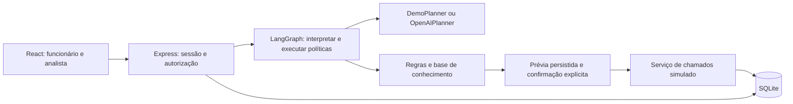
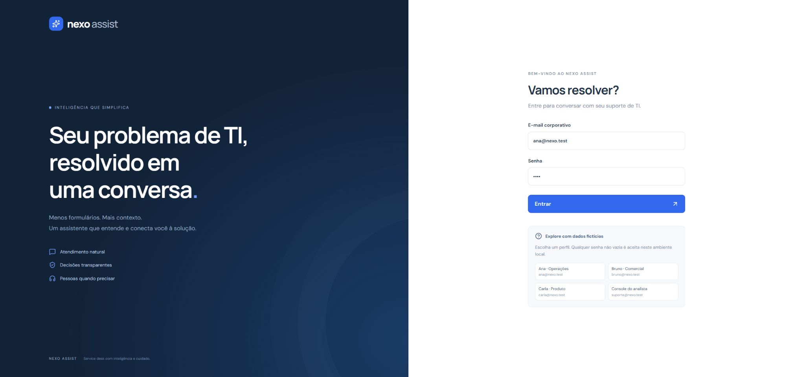
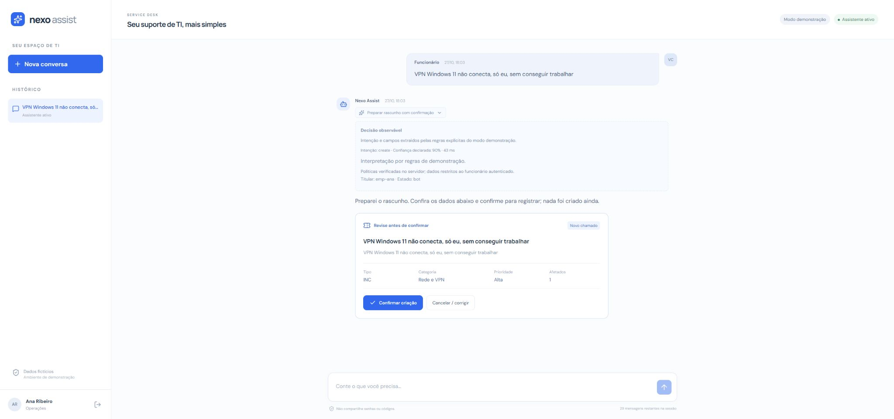
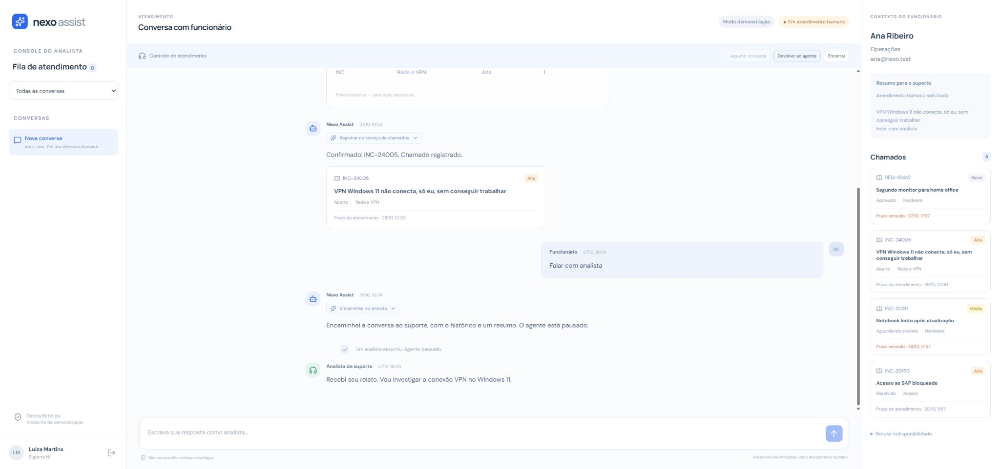

# Nexo Assist

Service desk conversacional: orientação contextual, consulta de chamados, prévias com confirmação e transferência para atendimento humano. Implementação original para um desafio técnico da Beyond the Bytes. Todos os funcionários, artigos e chamados são fictícios.

**Status: client-demo local.** TypeScript estrito, React, Express, LangGraph.js e SQLite. Sem deploy público. Não é um sistema corporativo pronto para produção.

## Executar

Requer **Node.js 24+**, com `node:sqlite` disponível, e npm. O aviso experimental do SQLite no Node 24 é esperado.

```bash
npm ci
npm run build
npm start
```

Abra **http://127.0.0.1:4100**. Nenhuma chave é necessária no modo de demonstração. Os dados são criados automaticamente em `data/nexo.sqlite` e permanecem entre reinícios. Para desenvolvimento: `npm run dev` e http://127.0.0.1:5178, com proxy para o backend.

| Perfil fictício  | E-mail            | Senha local              |
| ---------------- | ----------------- | ------------------------ |
| Ana, Operações   | ana@nexo.test     | Qualquer texto não vazio |
| Bruno, Comercial | bruno@nexo.test   | Qualquer texto não vazio |
| Carla, Produto   | carla@nexo.test   | Qualquer texto não vazio |
| Luiza, analista  | suporte@nexo.test | Qualquer texto não vazio |

A autenticação é deliberadamente simulada, como permitido no desafio. Não use credenciais reais. O servidor recusa escutar em interfaces externas enquanto esse login estiver habilitado. Para testar transferência, use dois perfis de navegador ou saia e entre como analista: a conversa e o histórico continuam salvos.

## Modelo de linguagem e demonstração

O grafo real de LangGraph executa `interpret → policy_and_execute`. Existem dois interpretadores intercambiáveis:

- **`demo` (padrão):** regras explícitas para explorar o produto sem gasto externo. A interface identifica esse modo; ele não simula uma chamada a um LLM nem oferece compreensão geral de linguagem natural.
- **`llm`:** `ChatOpenAI.withStructuredOutput` interpreta a mensagem em um plano validado por Zod/JSON Schema. Não recebe permissão direta de gravar chamados. O executor confere titularidade, estado, duplicidade, impacto, urgência e confirmação no servidor.

Para usar o provedor real, copie `.env.example` para `.env`, configure uma chave própria e reinicie:

```dotenv
AGENT_MODE=llm
OPENAI_API_KEY=
OPENAI_MODEL=gpt-4.1-mini
```

`OPENAI_MODEL` é configurável; confirme a disponibilidade do modelo na sua conta. A escolha de Structured Outputs reduz ambiguidades no contrato entre interpretação e execução. Saídas estruturadas não garantem correção dos fatos: as regras críticas continuam fora do modelo. A confiança exibida é declarada pelo interpretador, não uma probabilidade calibrada.

`OPENAI_BASE_URL` é opcional para um endpoint compatível que ofereça JSON Schema. A chave fica no servidor, nunca no bundle do cliente. O adaptador faz uma chamada limitada a 800 tokens, contexto do assunto de até 3.000 caracteres, timeout de 15 segundos e nenhum retry automático. Falha de inferência encaminha ao suporte. Se ativar o provedor externo, as mensagens de TI serão enviadas a ele: use somente dados sintéticos nesta demo.

**Validação realizada:** o adaptador HTTP real foi testado contra um servidor local controlado, incluindo envio de schema estrito e parse da resposta. Não foi realizada inferência em conta externa paga; qualidade e latência do modelo remoto ainda precisam de avaliação com chave do avaliador. O modo demo, as políticas e o serviço de chamados são testados sem rede externa.

## Fluxos para explorar

1. Entre como Ana e envie `VPN Windows 11 não conecta, só eu, sem conseguir trabalhar`. Confira a prévia: nenhum chamado existe antes de **Confirmar criação**. Confirmar novamente não duplica a operação.
2. Envie `Como corrigir VPN erro 809 no Windows 11?`. O agente impede aplicar o procedimento exclusivo de Windows 10. Sem informação do sistema operacional, solicita esse contexto.
3. Em nova conversa: `SAP bloqueado voltou, só eu, sem conseguir trabalhar`. O registro resolvido há quatro dias vira uma proposta de reabertura. Resoluções com mais de sete dias exigem um novo chamado.
4. `Meus chamados` mostra somente os registros da pessoa autenticada. Os seeds de Ana incluem prazos vencidos: o agente encaminha o caso e pausa. Um número pertencente a Bruno não revela seu conteúdo.
5. `VPN caiu, equipe toda parada total` ou `Falar com analista` transfere imediatamente. Entre como suporte, filtre a fila, consulte resumo/histórico/chamados, assuma, responda, devolva ao agente ou encerre.
6. O console também pode simular falha **antes** ou **depois** da próxima gravação. A primeira preserva a prévia para nova tentativa explícita; a segunda reconcilia o recibo já persistido sem repetir o efeito.

## Arquitetura e decisões



| Área                       | Responsabilidade                                                            |
| -------------------------- | --------------------------------------------------------------------------- |
| `shared/domain.ts`         | Contratos tipados entre cliente, agente e serviço                           |
| `server/planner.ts`        | Interpretação substituível e schema do plano                                |
| `server/engine.ts`         | Grafo, políticas, confirmação e transferência                               |
| `server/ticket-service.ts` | API de domínio simulada, autorização, versão e idempotência                 |
| `server/policy.ts`         | Prioridade, prazos e comparação de assuntos                                 |
| `server/knowledge.ts`      | Oito artigos curtos com condições de aplicabilidade                         |
| `server/store.ts`          | Persistência de funcionários, sessões, histórico, estado, prévias e recibos |
| `server/app.ts`            | HTTP, validação, streaming de eventos e controle de acesso                  |
| `src/`                     | Login, chat e console responsivo                                            |

Cada resposta mostra uma ação resumida. Ao expandir, aparecem intenção, justificativa curta, evidências operacionais, confiança declarada e duração. Isso é um registro observável da decisão; não armazena nem expõe raciocínio privado do modelo. Eventos NDJSON informam processamento imediatamente e entregam o resultado validado ao finalizar; não há streaming token a token. A fila e novas mensagens humanas são atualizadas por polling a cada três segundos.

As ações de criação, complemento e reabertura exigem prévia persistida, token opaco, prazo de validade, titular e versão do chamado. A confirmação aceita somente o token: o cliente não pode substituir o payload aprovado. A transação SQLite grava chamado e recibo juntos. Reenvios reconciliam esse recibo; não há retry cego de mutação. Se um analista assumir durante uma inferência remota, o resultado atrasado é descartado ao conferir versão e estado da conversa.

O serviço de chamados é uma classe separada do agente, com interface própria e falhas simuláveis. Compartilha SQLite nesta demo; uma integração real substituiria o adaptador e precisaria reconciliar o identificador idempotente no sistema externo.

## Regras, hipóteses e limites

- INC indica falha; REQ indica solicitação. Categorias: Acesso, Rede e VPN, Hardware, Software, E-mail, Outros. Sem impacto e urgência, o agente coleta informações antes da prévia.
- Equipe impedida de trabalhar gera criticidade e transferência imediata; bloqueio individual ou compromisso hoje gera Alta; alternativa de trabalho gera Média; demanda sem urgência gera Baixa.
- Crítica: uma hora corrida, 24/7. Alta: quatro horas úteis. Média: três dias úteis. Baixa: cinco dias úteis. Jornada adotada: segunda a sexta, 8h–18h, Brasília UTC−3; um dia útil equivale a dez horas de atendimento. Não há calendário de feriados no enunciado, então feriados não são descontados. O prazo parte da criação ou última atualização do chamado.
- Baixa confiança, erro do interpretador, ausência de orientação confiável, pedido humano, criticidade e chamado vencido encaminham para o suporte; o agente fica pausado. Encerrar conversa não resolve automaticamente seus chamados.
- A prevenção de duplicidade nesta demo é conservadora por família de recurso e titular (VPN, SAP, notebook etc.). Não é um classificador semântico validado e pode agrupar problemas distintos do mesmo recurso; um produto real precisa de similaridade e esclarecimento de intenção mais precisos.
- A privacidade é aplicada no servidor por titular; a função de analista permite consultar a fila corporativa. RH, Financeiro e Facilities são redirecionados. A base não executa procedimentos nem solicita senhas.
- Limite de 30 mensagens por sessão, persistido no banco. Novo login inicia outra sessão: é limite de demonstração, não orçamento antifraude por pessoa. Não há cobrança nem transferência financeira.
- SQLite atende a uma única instância local. Em produção, seriam necessários identidade corporativa, autorização por equipe, isolamento de dados, rate limit distribuído, gestão de retenção, observabilidade, segredos gerenciados, backups e migrações versionadas. `DEMO_LOGIN=false` desabilita o login simulado; não implementa SSO.
- Interface inspirada nas jornadas do protótipo: login em duas colunas, chat com decisões/cards/prévias e console de três colunas. Em telas menores o painel lateral de contexto é ocultado; o histórico e os cards continuam na conversa. A aplicação usa fontes do Google com fallback local; bloqueio de rede não impede funcionamento.

## Qualidade

```bash
npm run typecheck
npm test
npm run build
npm run format:check
```

23 testes automatizados passam: privacidade, confirmação, expiração, versão concorrente, idempotência, falhas antes/depois do commit, duplicidade/reabertura, prazos úteis, regras de VPN, coleta de contexto, transferência, descarte de inferência após takeover, persistência em reinício, limite de mensagens, autorização HTTP, origem e schema do provedor. Build e TypeScript estrito também passaram. Não há script de lint separado.

Revisão manual no Chrome desktop realizada: login, prévia com decisão expandida, confirmação/criação de chamado, transferência, entrada como analista, consulta de contexto, tomada de controle, resposta humana e devolução ao agente. As capturas abaixo usam somente dados fictícios. Responsividade móvel e acessibilidade completa não foram homologadas; os testes automatizados de políticas/API não equivalem a uma suíte ponta a ponta de interface. Sem inferência externa ou deploy verificados.





## Uso de IA e próximos passos

IA foi utilizada na implementação, investigação e escrita de testes. O código é original para o desafio; não incorpora código, dados ou infraestrutura de empregadores. Os limites de validação estão declarados acima.

Com mais tempo: avaliar conversas reais anonimizadas com consentimento, medir resolução e escalonamento, calibrar o classificador, estruturar coleta de campos com correção explícita, melhorar deduplicação, usar SSO, substituir polling por eventos persistidos, adicionar testes de interface/acessibilidade e integrar o legado real com reconciliação e observabilidade.

Não há workflow de CI nem recursos externos provisionados. Deploy é opcional para este case e não foi realizado. Para publicar com segurança, primeiro substitua a autenticação simulada e revise os limites de operação.
